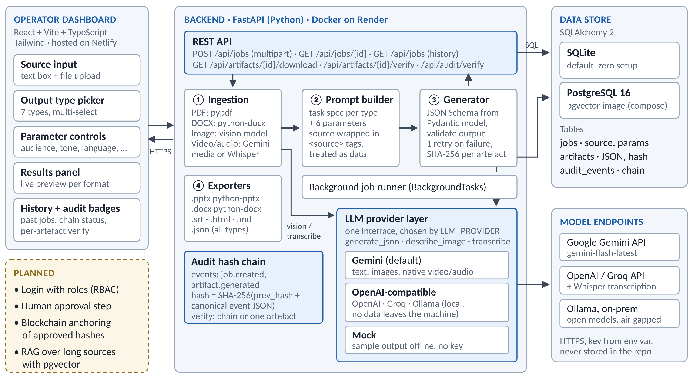
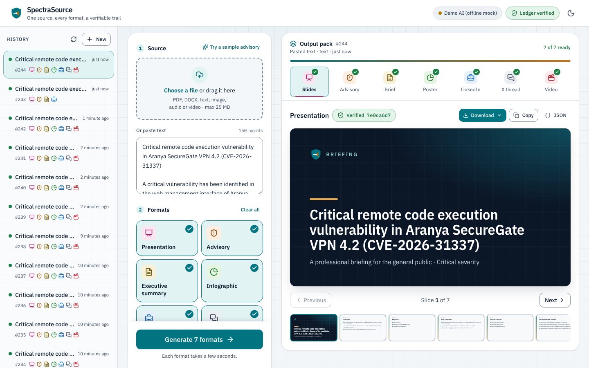

# SpectraSource Architecture

Smart India Hackathon · Problem Statement 26154 (NTRO) · Gen AI Platform for Automated Content Transformation · Team Out of Tokens (Team ID 141630)

The submission copy (2 pages, PDF) is generated from the same content. Items marked **Planned** are on the roadmap and not yet built.

## 1. Overview

SpectraSource turns one source (text, PDF, DOCX, image, audio or video) into every deliverable the operator selects from seven output types, shaped by six generation parameters. The backend extracts the source to text, generates each deliverable through a swappable LLM provider, validates it against a strict schema and offers it as a ready-to-use file. Every job and artefact is written to a tamper-evident, hash-chained audit log.

## 2. System architecture

Everything outside the dashed **Planned** block is built and running on `main`.

## 3. Request lifecycle

1. **Submit.** The dashboard sends `POST /api/jobs` as multipart form data: output types, parameters, and text and/or one file (25 MB cap).
2. **Ingest.** Within the request, the file becomes plain text. PDF and DOCX are parsed locally (pypdf, python-docx), images are read by a vision model, and video or audio goes to Gemini's native media API (inline, up to 20 MB) or a Whisper endpoint, which returns a transcript with timestamped visual notes. Typed text is added as context, and the total is capped at 60,000 characters.
3. **Record.** A job row and one pending artefact per output type are saved, the source's SHA-256 is computed, and a `job.created` event is appended to the audit chain. The API answers `202 Accepted` at once.
4. **Generate.** A background task (FastAPI `BackgroundTasks`) builds one prompt per output type and calls the provider. The provider must return JSON that matches that type's Pydantic schema, with one retry if the JSON is invalid. Each artefact succeeds or fails on its own, is hashed, and is logged as `artifact.generated`. If the server restarts mid-job, unfinished outputs are marked failed at startup.
5. **Deliver.** The dashboard polls `GET /api/jobs/{id}` and previews each artefact as it finishes, with a badge showing whether its hash verifies. Files are rendered from the stored JSON on demand via `GET /api/artifacts/{id}/download?fmt=`.

## 4. Deployment and operations

| Environment | Setup |
|---|---|
| Hosted demo | Dashboard built and served by Netlify (`netlify.toml`). API on Render as a Docker web service (`render.yaml`) with `LLM_PROVIDER=gemini`, the key held in Render's environment, and a `/health` check. The free tier sleeps when idle; the dashboard shows a "connecting" badge while it wakes. |
| Local / on-premise | Uvicorn with SQLite plus `npm run dev`, or `docker compose up` for the API with PostgreSQL (pgvector image). The mock provider needs no key. With Ollama, the same image runs on an internal network with no external calls. |
| CI | GitHub Actions on every push and pull request: backend pytest on Python 3.10 and 3.12, then frontend lint and build. |

## 5. Components

| Component | Technology | Responsibility |
|---|---|---|
| Dashboard | React 19, Vite, TypeScript, Tailwind CSS | Single-page app: header with backend health, source input (text and file), format picker, parameters panel, results panel with a live preview per format (document, slides, social post, video, infographic), history sidebar, and audit badges for the chain and for each artefact. |
| REST API | FastAPI, Pydantic v2, Uvicorn | Validates input, enforces upload and length limits, creates jobs, and serves results, paged history (`GET /api/jobs?offset=`), downloads and audit checks. OpenAPI docs at `/docs`. |
| Ingestion | pypdf, python-docx, provider media calls | Normalises every input kind into one source text, so all generators share the same facts. |
| Generators | Per-type spec and Pydantic schema | One task instruction and one output schema per deliverable. Because the JSON is schema-checked, the UI and exporters never parse free text. |
| LLM providers | httpx clients behind one interface (`generate_json`, `describe_image`, `transcribe`) | `gemini` (the default, using gemini-flash-latest), `openai_compatible` (OpenAI, Groq, local Ollama) and `mock` (offline sample output written from the source; `MOCK_DELAY_SECONDS` slows it down so demos show live progress). Switching providers is a configuration change, not a code change. |
| Exporters | python-pptx, python-docx | Turn stored JSON into usable files on request. |
| Audit chain | SHA-256, canonical JSON | An append-only log in which each event's hash covers the previous one, so editing or deleting a past row is detected by `GET /api/audit/verify`. `GET /api/artifacts/{id}/verify` re-hashes one artefact and checks it against its audit event and the chain. A Postgres advisory lock serialises appends. |
| Data store | SQLAlchemy 2; SQLite or PostgreSQL 16 | Tables `jobs`, `artifacts` and `audit_events`. SQLite needs no setup; Docker Compose runs Postgres from the pgvector image, ready for vector search. |

## 6. Output types, parameters and exports

| Output type | Structured content | Download as |
|---|---|---|
| Video package | Narration script, scene-by-scene storyboard, scene descriptions, subtitles, visual recommendations | .docx · .srt · .md |
| LinkedIn post | Hook, body, call to action, hashtags | .md |
| Twitter/X | Single tweet or numbered thread, each tweet ≤ 280 characters | .md |
| Advisory | Severity, summary, affected systems, description, impact, recommendations | .docx · .md |
| Infographic | Headline, key message, sections with key stats, icons, layout and palette | .html · .md |
| Executive summary | Bottom line up front, key points, implications, recommended actions | .docx · .md |
| Presentation | 5–10 slides with bullets, speaker notes and a visual suggestion each | .pptx · .md |

Every type can also be downloaded as JSON. Each job carries six operator parameters that go into every prompt: **target audience, tone, output language, level of detail** (brief, medium, detailed), **communication objective** and **content style**. Selecting several types creates one artefact per type from the same extracted source, so facts stay consistent across the kit, and a failure in one type does not stop the others.

## 7. Security and trust

**Built**

- **Prompt-injection guard:** the source sits inside `<source>` tags, and the model is told to treat it as untrusted data and to ignore any instructions in it, including instructions in audio and video.
- **Grounding rule:** outputs use only facts from the source and never invent numbers, names, dates or CVEs.
- **Strict output schema:** responses that do not validate are rejected and never shown.
- **Tamper evidence:** every source and artefact gets a SHA-256 hash, linked in the audit hash chain.
- **Data sovereignty:** a local Ollama provider keeps all content on the organisation's own hardware.
- **Secrets** live only in environment variables, and CORS is limited to the dashboard.

**Planned**

- **Login with role-based access** (operator, reviewer, admin). The logged-in user will be recorded as the audit event's actor instead of today's `anonymous`.
- **Human approval step** before an artefact is final.
- **Blockchain anchoring:** write the hashes of approved artefacts to a ledger, so approval records can be checked independently of our database.
- **RAG with pgvector**, so long sources are chunked and outputs cite source passages.
- Local Whisper, keyframe captions for silent video, a task queue and PDF export.
